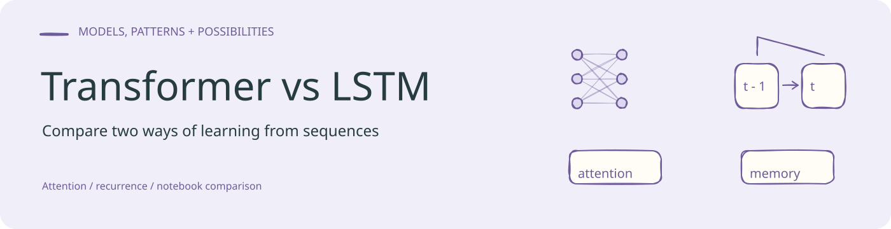
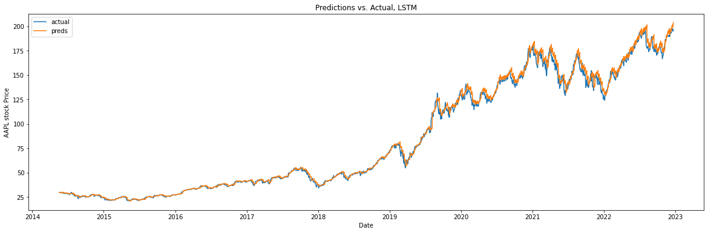

<!-- readme-visual-refresh:banner -->

<!-- /readme-visual-refresh:banner -->

| file                 | description          |
| -------------------- | -------------------- |
| lstm_vs__transformer | notebook             |
| history.pkl          | data have downloaded |
| history.csv          | data table           |

<!-- readme-visual-refresh:artwork-source -->
[Editable banner artwork · Excalidraw](assets/readme/banner.excalidraw)
<!-- /readme-visual-refresh:artwork-source -->

<!-- readme-visual-refresh:result -->
## Saved project output

Existing LSTM-versus-observation stock-price time-series visualization from the example notebook.

Historical project output, retained from the existing working files; it was not rerun for this documentation update.

Source: `lstm_vs__transformer.ipynb [zero-based cell 27, output 0]`.
<!-- /readme-visual-refresh:result -->
